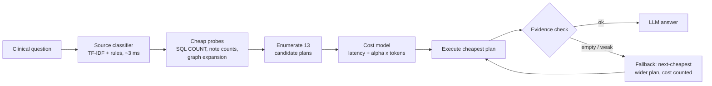
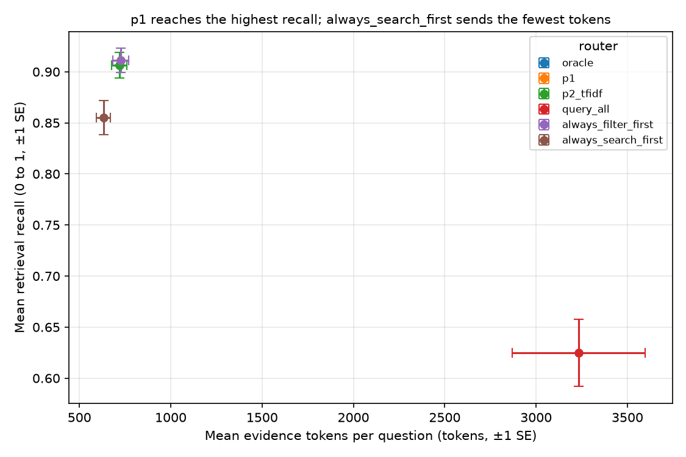
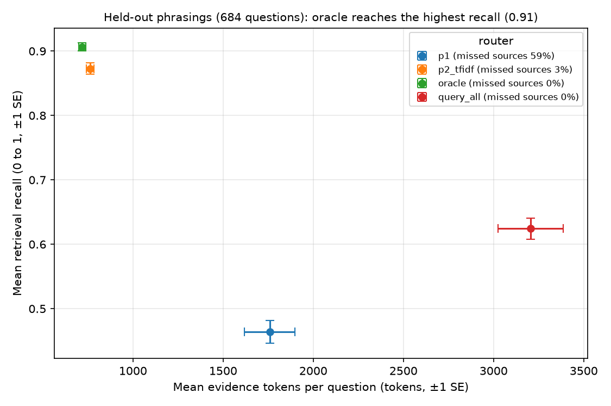
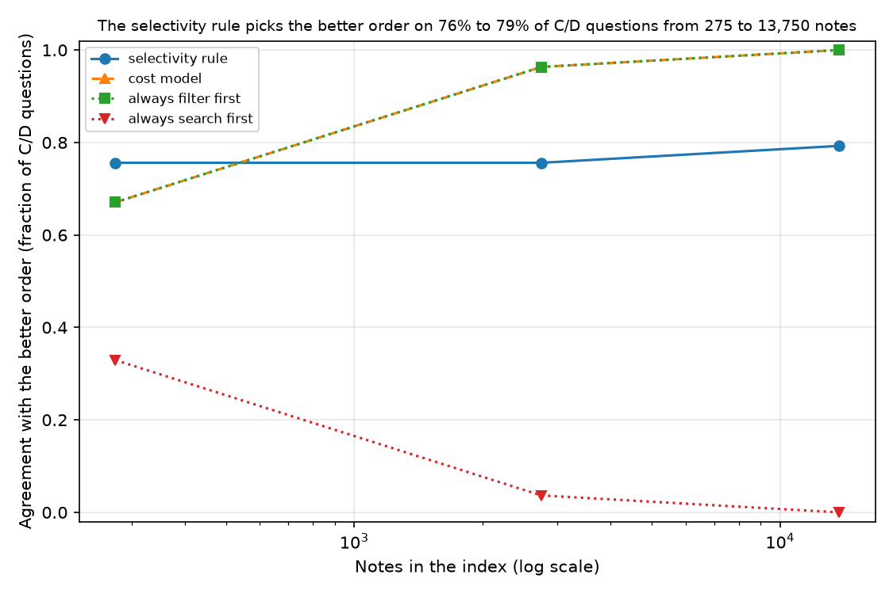

# Cost-Aware Retrieval Planning for Clinical RAG

A query optimizer for retrieval-augmented generation over heterogeneous clinical data. For each question it decides which sources to query (SQL tables, clinical notes, a diagnosis-code graph) and in what order, using cheap probes and a cost model instead of an LLM call, so the LLM gets far less text at the same or better recall.

Course research project for CSE 598 Data-Intensive Systems for Machine Learning, Arizona State University, Fall 2026.

## The problem

Clinical questions often need more than one kind of data. A lab value lives in a table, the reason for a treatment lives in a free-text discharge note, and "any cardiovascular diagnosis" lives in the ICD code hierarchy. Most RAG systems either search a single vector index and miss what it can't hold, or query every source and send everything to the LLM. The second option is slow, expensive in tokens, and long contexts can hurt accuracy.

This project treats retrieval like a database query: enumerate the possible retrieval plans, estimate what each would cost, and run the cheapest one that covers what the question needs.

## How it works



Three sources sit behind one interface (`src/clinrag/sources/base.py`):

- **Relational**: DuckDB over hospital tables (admissions, diagnoses, labs)
- **Notes**: vector search over discharge notes, optionally restricted to a list of admissions
- **Graph**: the ICD diagnosis hierarchy (chapters and blocks), version-aware for ICD-9 and ICD-10

Key ideas:

1. **Probe-based cost estimation.** Relational optimizers rely on stored statistics that vector indexes and graphs don't keep. Instead, the planner runs cheap probes (a SQL count, a note count, a graph expansion) and only when a decision depends on them. Plan cost = estimated latency + alpha x estimated tokens sent to the LLM, with constants calibrated from measured timings.
2. **Filter ordering.** When a question combines a structured filter with note search, the planner chooses pre-filtering (search only the matching admissions' notes) or post-filtering (search everything, then drop non-matching results).
3. **LLM-free source selection with a fallback.** A small logistic-regression classifier predicts which sources a question needs. If the chosen plan returns empty or weak evidence, the planner runs the next-cheapest wider plan and counts the extra cost.

## Results

All numbers are from the open MIMIC-IV Clinical Database Demo (275 admissions) with generated discharge notes, on a held-out test split. Tuning and training used the dev split only. Frozen as tag `results-demo-v1`.

| Finding | Result |
|---|---|
| Tokens sent to the LLM vs querying every source | 78% fewer (719 vs 3,233 per question), with recall 0.91 vs 0.63 |
| Same comparison with a BGE + FAISS notes index | 73% fewer (840 vs 3,088), with recall 0.91 vs 0.68 |
| Source routing on question wordings never seen in training | 89% exact (TF-IDF) and 94% (BGE) vs 41% for keyword rules |
| End to end on unseen wordings | Recall 0.87 vs 0.46 for keyword rules, at 57% fewer tokens |
| Cost model ranking vs measured cost | Spearman 0.86 overall, 0.93 on tokens |
| Wrong filter order on a large index | Post-filtering loses up to 86% of recall at 13,750 notes (0.12 vs 0.83) |
| Planning time | 0.04 to 3 ms for single-source questions, 8 to 17 ms for filter-plus-search questions |
| Reusing one query embedding across probe and search (BGE + FAISS) | Retrieval time 57% to 62% lower for the cost-based and fixed-order routers (43% for query-all), end to end about a third lower, same results |
| Ablations | On the demo, the gains come from source selection and pre-filtering; removing the probes or the fallback changes recall by under 1 point |





## Quick start (no MIMIC access needed)

```bash
pip install -e ".[dev]"
pytest
```

The test suite runs on a small made-up dataset in `tests/fixtures/` that uses MIMIC-IV column names.

To reproduce the demo results on the open MIMIC-IV demo:

```bash
bash scripts/download_demo.sh
python -m clinrag.workload.notes_gen --tables-dir data/mimic-iv-demo --out-dir data/generated --seed 0
python -m clinrag.workload.build --tables-dir data/mimic-iv-demo --notes-dir data/generated --out-dir data/workload --seed 0
python -m clinrag.eval.calibrate --sources reference --workload data/workload --split dev --out outputs/calibrated_config.yaml
python -m clinrag.eval.runner --sources reference --workload data/workload --split test --config outputs/calibrated_config.yaml --out outputs/runs/test
```

The exact command behind every number above is in `docs/experiments.md` (frozen demo results), `docs/results/COMPARISON.md` (BGE + FAISS runs and the query-embedding cache) and `docs/results/ABLATIONS.md` (ablations).

## Repository layout

```
src/clinrag/
  question.py        question spec: class, filter, note query, category, required sources
  sources/           source interfaces, DuckDB and notes sources, ICD graph, FAISS notes source
  planner/           probes, cost model, order rule, plan enumerator, planner, executor,
                     source classifier, rule planner, evidence-check fallback
  workload/          synthetic note generator, question templates, gold answers, paraphrases
  eval/              runner, calibration, analyses, figures, shared metrics
  llm/               answer-step interface
tests/               fixture-based tests, run in CI on every push
docs/                design notes, experiments, figures
```

## Data and privacy

- No MIMIC data, derived tables, embeddings or model outputs are ever committed. `data/` and `outputs/` are gitignored.
- Credentialed MIMIC-IV is used only by credentialed team members, on approved storage, never sent to any third-party service, per the PhysioNet Credentialed Health Data Use Agreement.
- The published results use only the open-access MIMIC-IV demo and notes generated from it.

## Limitations

- Results are on a 275-admission demo with generated notes. Real discharge notes are longer and messier, and a full MIMIC-IV run (about 330K notes) is planned.
- Questions come from templates, with generated paraphrases to test routing on unseen wording. They were not written by clinicians.
- Structured slots (lab, threshold, diagnosis category) are assumed to be extracted correctly from the question.
- On the small demo, planning overhead is comparable to retrieval time; it should be a small fraction once LLM generation time is included.
- The planner chooses filter order with a selectivity rule tuned on dev (filter-first when fewer than half the notes match). At larger index sizes, letting the cost model decide (or always pre-filtering) matched the better order more often, so moving the order decision into the cost model is planned.
- On a 275-note index, the probes and the evidence-check fallback add little. The fallback only fires with dense (BGE) similarity scores, and the probes matter more as the index grows.

## Team

- Mrudula Eluri: query planner (cost model, probes, filter ordering, source classifier, fallback), question workload and evaluation benchmark, experiment runner
- Diya Shrivastava: relational store and diagnosis graph
- Dylan Forrest: vector retrieval (BGE + FAISS), baselines, LLM answer step
