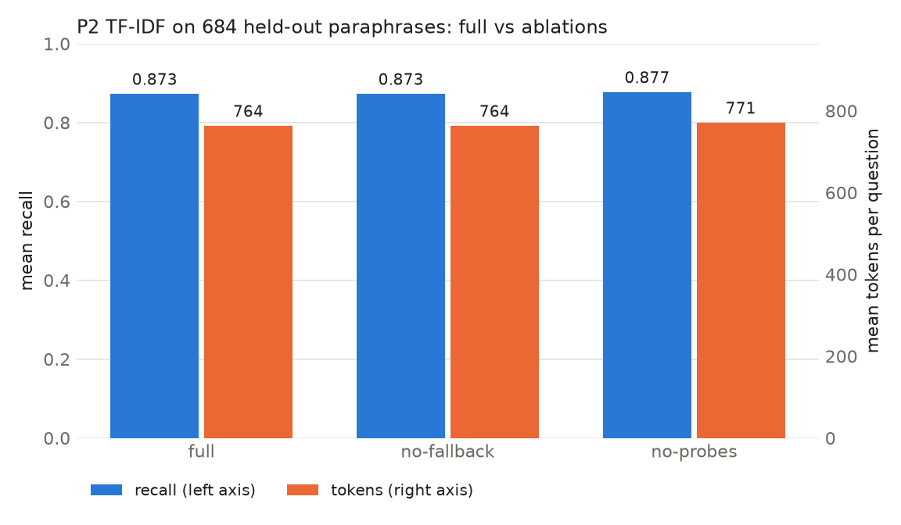

# Ablations: fallback and probes

Sources: `--sources reference` (DuckDB demo tables, TF-IDF notes, ICD graph); no BGE. Config: results-demo-v1's
`outputs/runs/final-demo/config/calibrated_config.yaml` unchanged (`s = 0.5`, `beta = 1.0`, `min_similarity` 0.050).
Branch `experiments/ablations` (11bf442 switches, e00ff7c tests) off `results-demo-v1` (5acdd60). One router per process,
3 repeats per question; power was AC at the start and end of every part (`run.log`).

- **full**: the rows of `results-demo-v1` (`final-demo/template-test`, `final-demo/paraphrase-test`), reused, not rerun.
- **no-fallback** (`--no-fallback`): the chosen plan runs once, whatever the evidence check says.
- **no-probes** (`--no-probes`): no relational count, note count, graph expansion or trial search during planning; every
  plan is still enumerated and costed, from fixed defaults: relational rows = 4 and graph codes = 18 (medians over the
  calibration queries and categories on dev), matching notes = round(0.3 x total notes) = 82 of 275, matching admissions = matching
  notes (one note per admission in this index). Questions without an order choice (classes A and B) run no probes in either mode.

"C/D filter-first share" is the share of class C and D questions whose chosen plan (the first one executed) is the
filter-first variant; "C/D search-first share" the search-first one.

**Timing noise floor.** no-fallback did exactly the same work as full on every question (same plan, recall and tokens:
171/171 and 684/684), so its timing differences from full (-0.8 to +3.4 ms mean latency, -1.1 to +2.3 ms overhead) are
run-to-run noise between today and the results-demo-v1 runs. Latency differences smaller than that are not meaningful.

## Template test (171 questions)

| router | variant | n | recall | tokens | mean latency ms | planning overhead ms | fallback rate | missed sources | C/D filter-first share | C/D search-first share | C/D recall |
|---|---|---|---|---|---|---|---|---|---|---|---|
| p2_tfidf | full (results-demo-v1) | 171 | 0.906 | 719 | 7.87 | 8.97 | 0.000 | 0.000 | 0.793 | 0.207 | 0.820 |
| p2_tfidf | no-fallback | 171 | 0.906 | 719 | 9.62 | 11.29 | 0.000 | 0.000 | 0.793 | 0.207 | 0.820 |
| p2_tfidf | no-probes | 171 | 0.911 | 726 | 9.53 | 3.10 | 0.000 | 0.000 | 1.000 | 0.000 | 0.829 |
| oracle | full (results-demo-v1) | 171 | 0.906 | 719 | 6.95 | 6.63 | 0.000 | 0.000 | 0.793 | 0.207 | 0.820 |
| oracle | no-fallback | 171 | 0.906 | 719 | 6.37 | 5.56 | 0.000 | 0.000 | 0.793 | 0.207 | 0.820 |
| oracle | no-probes | 171 | 0.911 | 726 | 5.91 | 0.09 | 0.000 | 0.000 | 1.000 | 0.000 | 0.829 |

On the template set neither idea moves quality: fallback never fires (rate 0.000 in every run, because the TF-IDF similarity floor
of 0.050 was never missed in these runs), and dropping the probes changes only the 17 C/D questions where the probes saw an unselective
filter (66-100% of notes matching) and chose search-first, which forced to filter-first gain recall on 4 and lose it on none
(0.694 -> 0.741 on those 17) for ~78 more tokens each, so what the probes buy here is about 7 tokens per question, paid for with
6.5 ms of planning overhead for oracle (6.63 -> 0.09 ms) and 5.9 ms for P2 (8.97 -> 3.10 ms, the rest is the classifier).

## Paraphrase end to end (684 held-out test paraphrases)

| router | variant | n | recall | tokens | mean latency ms | planning overhead ms | fallback rate | missed sources | C/D filter-first share | C/D search-first share | C/D recall | recall A | recall B | recall C | recall D |
|---|---|---|---|---|---|---|---|---|---|---|---|---|---|---|---|
| p2_tfidf | full (results-demo-v1) | 684 | 0.873 | 764 | 7.75 | 9.18 | 0.000 | 0.034 | 0.793 | 0.207 | 0.820 | 0.866 | 0.974 | 0.833 | 0.805 |
| p2_tfidf | no-fallback | 684 | 0.873 | 764 | 6.93 | 8.24 | 0.000 | 0.034 | 0.793 | 0.207 | 0.820 | 0.866 | 0.974 | 0.833 | 0.805 |
| p2_tfidf | no-probes | 684 | 0.877 | 771 | 6.66 | 2.25 | 0.000 | 0.034 | 1.000 | 0.000 | 0.829 | 0.866 | 0.974 | 0.848 | 0.810 |
| oracle | full (results-demo-v1) | 684 | 0.906 | 719 | 5.14 | 4.90 | 0.000 | 0.000 | 0.793 | 0.207 | 0.820 | 1.000 | 0.974 | 0.833 | 0.805 |
| oracle | no-fallback | 684 | 0.906 | 719 | 8.52 | 6.73 | 0.000 | 0.000 | 0.793 | 0.207 | 0.820 | 1.000 | 0.974 | 0.833 | 0.805 |
| oracle | no-probes | 684 | 0.911 | 726 | 4.47 | 0.07 | 0.000 | 0.000 | 1.000 | 0.000 | 0.829 | 1.000 | 0.974 | 0.848 | 0.810 |

Under held-out phrasings the picture is the same: fallback still never fires, so it does not rescue P2's 3.4% of plans that miss a
needed source (missed sources 0.034 in all three P2 rows, recall 0.873 with or without it), and without probes the 68 C/D
questions that had gone search-first go filter-first (recall 0.694 -> 0.741 on those, classes C 0.833 -> 0.848 and D 0.805 -> 0.810),
so on this demo index the probes contribute only a small token saving and their overhead (4.90 -> 0.07 ms oracle, 9.18 -> 2.25 ms P2).



`docs/figures/fig7_ablations.png`: P2 TF-IDF on the paraphrase set, recall (left axis) and mean tokens (right axis) per variant.

## Reproduce

```
bash outputs/runs/ablations/tools/run_ablations.sh
python outputs/runs/ablations/tools/write_ablations.py
```
